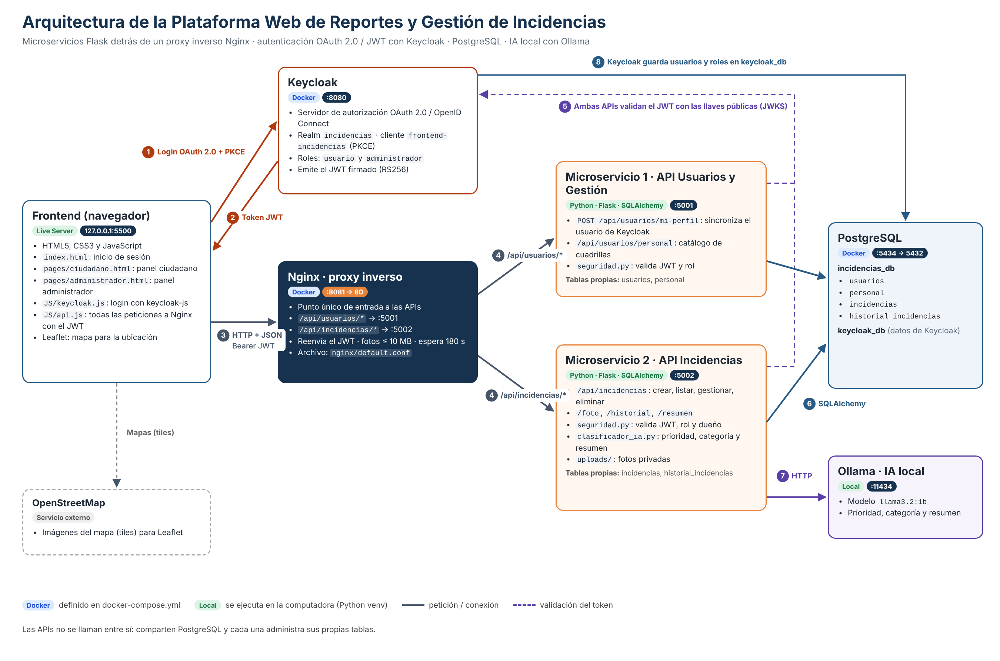
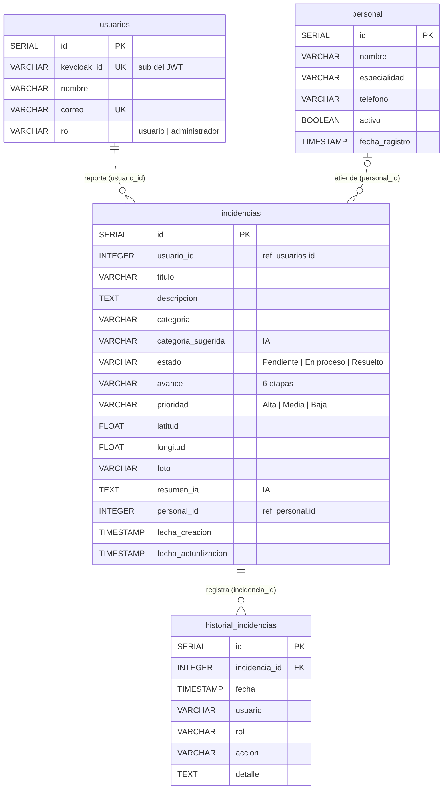

# Plataforma Web de Reportes y Gestión de Incidencias

Proyecto final del curso **Desarrollo Web** · Universidad Mariano Gálvez de Guatemala, Centro Universitario de Retalhuleu.

Sistema web para que la ciudadanía reporte problemas de infraestructura y servicios públicos (alumbrado, agua, calles, incendios, etc.) con descripción, fotografía y ubicación en un mapa, y para que el personal administrativo de una municipalidad los clasifique, priorice, asigne a una cuadrilla y les dé seguimiento hasta resolverlos. Una IA local apoya la clasificación y genera resúmenes.

---

## Contenido

1. [Arquitectura](#1-arquitectura)
2. [Flujo de comunicación](#2-flujo-de-comunicación)
3. [Microservicios](#3-microservicios)
4. [Modelo relacional de la base de datos](#4-modelo-relacional-de-la-base-de-datos)
5. [Seguridad](#5-seguridad)
6. [Inteligencia artificial](#6-inteligencia-artificial)
7. [Frontend y funcionalidades por rol](#7-frontend-y-funcionalidades-por-rol)
8. [Estructura del repositorio](#8-estructura-del-repositorio)
9. [Instalación y ejecución](#9-instalación-y-ejecución)

---

## 1. Arquitectura



La solución sigue una **arquitectura de microservicios**. El navegador nunca llama directamente a las APIs: todas las peticiones pasan por **Nginx**, que funciona como **proxy inverso** y punto único de entrada. La autenticación la resuelve **Keycloak** con OAuth 2.0 / OpenID Connect, y cada microservicio valida el token **JWT** antes de atender una petición.

| Componente | Tecnología | Dónde se ejecuta | Puerto | Responsabilidad |
|---|---|---|---|---|
| Frontend | HTML5, CSS3, JavaScript, Leaflet | Live Server | 5500 | Inicio de sesión, panel ciudadano y panel administrador |
| Keycloak | Keycloak 26 | Docker | 8080 | Servidor de autorización: usuarios, contraseñas, roles y emisión de JWT |
| Nginx | Nginx (alpine) | Docker | 8081 → 80 | Proxy inverso: enruta `/api/usuarios/*` y `/api/incidencias/*` |
| **API Usuarios y Gestión** | Python, Flask, SQLAlchemy | Local (venv) | 5001 | Microservicio 1: usuarios, roles y catálogo de personal |
| **API Incidencias** | Python, Flask, SQLAlchemy | Local (venv) | 5002 | Microservicio 2: incidencias, fotos, seguimiento, historial e IA |
| PostgreSQL | PostgreSQL 17 | Docker | 5434 → 5432 | Base `incidencias_db` (datos del sistema) y `keycloak_db` (datos de Keycloak) |
| Ollama | Ollama + `llama3.2:1b` | Local | 11434 | Modelo de IA local para prioridad, categoría y resumen |
| OpenStreetMap | Servicio externo | Internet | — | Imágenes del mapa (tiles) que muestra Leaflet |

**Decisiones de diseño**

- **Separación por responsabilidad, no por rol.** Un microservicio gestiona a las *personas* (usuarios y personal) y el otro los *reportes*. Ambos roles (ciudadano y administrador) usan los dos microservicios; lo que cambia es el rol que trae el JWT.
- **Las APIs no se llaman entre sí por HTTP.** Comparten la base PostgreSQL, pero **cada una crea y administra únicamente sus propias tablas**. La API de Incidencias solo *lee* `usuarios` y `personal` para mostrar nombres y validar asignaciones.
- **Nginx en Docker y APIs en la computadora.** Nginx llega a las APIs mediante `host.docker.internal`, la dirección con la que un contenedor accede al equipo anfitrión.
- **IA local.** Se usa Ollama en lugar de un servicio en la nube: no tiene costo y los datos de los ciudadanos no salen del equipo.

---

## 2. Flujo de comunicación

Los números coinciden con las flechas del diagrama.

| # | Desde → Hacia | Protocolo | Qué ocurre |
|---|---|---|---|
| 1 | Frontend → Keycloak | OAuth 2.0 (Authorization Code + PKCE) | El usuario pulsa «Iniciar sesión» y el navegador se redirige al formulario de Keycloak. La aplicación nunca recibe la contraseña. |
| 2 | Keycloak → Frontend | OpenID Connect | Keycloak devuelve un **token JWT** firmado (RS256) con el usuario (`sub`, nombre, correo) y sus **roles**. Según el rol, el frontend abre el panel ciudadano o el de administrador. |
| 3 | Frontend → Nginx | HTTP + JSON | Cada petición se envía a `http://localhost:8081` con el encabezado `Authorization: Bearer <JWT>` (`frontend/JS/api.js`). |
| 4 | Nginx → API | HTTP (proxy) | Nginx revisa la ruta: `/api/usuarios/*` va al puerto **5001** y `/api/incidencias/*` al **5002** (`nginx/default.conf`). Reenvía el token. |
| 5 | API → Keycloak | HTTPS/HTTP (JWKS) | Cada API descarga las **llaves públicas** de Keycloak y con ellas verifica localmente la firma, el emisor, la audiencia, la expiración y el rol del token (`seguridad.py`). |
| 6 | API → PostgreSQL | SQL (SQLAlchemy) | La API consulta o guarda la información en `incidencias_db`. |
| 7 | API Incidencias → Ollama | HTTP (`/api/generate`) | Al crear un reporte o pedir un resumen, `clasificador_ia.py` envía el texto al modelo de IA. |
| 8 | Keycloak → PostgreSQL | JDBC | Keycloak guarda sus propios datos (usuarios, contraseñas cifradas, roles) en `keycloak_db`. |

Después, la API responde en **JSON** por el mismo camino (API → Nginx → Frontend) y el frontend muestra el resultado.

**Ejemplo: un ciudadano registra un reporte**

1. Al abrir su panel, el frontend llama `POST /api/usuarios/mi-perfil` → **API Usuarios** guarda o actualiza al ciudadano en `usuarios` usando el `sub` del token como `keycloak_id`.
2. El ciudadano envía el formulario → `POST /api/incidencias` (con foto y coordenadas) → Nginx → **API Incidencias**.
3. La API valida el token y el rol `usuario`, busca el `id` del ciudadano en `usuarios` por su `keycloak_id`, consulta a la IA (prioridad y categoría), guarda la foto en `uploads/`, inserta la fila en `incidencias` y registra «Reporte recibido» en `historial_incidencias`.
4. Responde `201` con el número de reporte y la prioridad asignada.

---

## 3. Microservicios

### Microservicio 1 · API Usuarios y Gestión (`api-usuarios/`, puerto 5001)

**Responsabilidad:** sincronizar los usuarios de Keycloak con la base de datos, manejar sus roles y administrar el catálogo de personal (cuadrillas) que atiende las incidencias.

**Tablas propias:** `usuarios`, `personal`

| Método | Ruta | Rol | Descripción |
|---|---|---|---|
| POST | `/api/usuarios/mi-perfil` | usuario, administrador | Crea o actualiza el usuario autenticado a partir del JWT |
| GET | `/api/usuarios` | administrador | Lista los usuarios |
| POST | `/api/usuarios` | administrador | Crea un usuario |
| GET | `/api/usuarios/personal` | administrador | Lista el personal (`?activos=1` solo disponibles) |
| POST | `/api/usuarios/personal` | administrador | Registra personal `{nombre, especialidad, telefono}` |
| PATCH | `/api/usuarios/personal/<id>` | administrador | Actualiza nombre, especialidad, teléfono o disponibilidad (`activo`) |
| DELETE | `/api/usuarios/personal/<id>` | administrador | Elimina personal; responde `409` si tiene incidencias sin resolver |

**Archivos:** `app.py` (aplicación Flask, modelos y rutas) · `seguridad.py` (validación del JWT) · `requirements.txt` · `.env.example`

### Microservicio 2 · API Incidencias (`api-incidencias/`, puerto 5002)

**Responsabilidad:** todo el ciclo de vida de un reporte: registro con foto y ubicación, consulta, clasificación, prioridad, asignación de responsable, etapas de seguimiento, historial de cambios e integración con la IA.

**Tablas propias:** `incidencias`, `historial_incidencias`

| Método | Ruta | Rol | Descripción |
|---|---|---|---|
| GET | `/api/incidencias` | usuario, administrador | El ciudadano recibe solo sus incidencias; el administrador, todas |
| POST | `/api/incidencias` | usuario | Crea una incidencia (JSON o `multipart/form-data` con `foto`); asigna prioridad y categoría sugerida con IA |
| GET | `/api/incidencias/<id>` | dueño o administrador | Detalle de la incidencia con su historial |
| PATCH | `/api/incidencias/<id>` | administrador | Actualiza `prioridad`, `categoria`, `avance`, `estado`, `personal_id` y `comentario`; registra cada cambio |
| DELETE | `/api/incidencias/<id>` | dueño | Elimina el reporte solo si sigue en «Reporte recibido» (`409` si ya está en atención) |
| GET | `/api/incidencias/<id>/foto` | dueño o administrador | Entrega la fotografía (acceso protegido) |
| GET | `/api/incidencias/<id>/historial` | dueño o administrador | Historial de la incidencia |
| GET | `/api/incidencias/historial` | administrador | Historial general (`?limite=200`) |
| POST | `/api/incidencias/<id>/resumen` | administrador | Genera y guarda un resumen con IA |
| POST | `/api/incidencias/sugerir-categoria` | usuario, administrador | Sugiere la categoría a partir de `{titulo, descripcion}` |
| GET | `/api/incidencias/catalogos` | usuario, administrador | Categorías, estados, prioridades y etapas |

**Archivos:** `app.py` (aplicación Flask, modelos y rutas) · `seguridad.py` (validación del JWT) · `clasificador_ia.py` (integración con Ollama) · `uploads/` (fotos, no se sube al repositorio) · `requirements.txt` · `.env.example`

**Etapas de seguimiento**

| Etapa visible para el ciudadano | Estado oficial |
|---|---|
| 1. Reporte recibido | Pendiente |
| 2. En revisión | Pendiente |
| 3. Personal asignado | En proceso |
| 4. Personal en camino | En proceso |
| 5. Trabajo en proceso | En proceso |
| 6. Resuelto | Resuelto |

La primera gestión del administrador mueve el reporte a «En revisión» (desde ese momento el ciudadano ya no puede eliminarlo) y la asignación de un responsable lo avanza a «Personal asignado». Las demás etapas las actualiza el administrador.

**Categorías:** Alumbrado público, Fuga de agua, Calles dañadas, Infraestructura, Incendios y Otros.

---

## 4. Modelo relacional de la base de datos



Script completo: [`database/schema.sql`](database/schema.sql)

| Tabla | Microservicio dueño | Descripción |
|---|---|---|
| `usuarios` | API Usuarios | Usuarios sincronizados desde Keycloak (`keycloak_id` = `sub` del JWT) |
| `personal` | API Usuarios | Trabajadores o cuadrillas, con especialidad y disponibilidad |
| `incidencias` | API Incidencias | Reportes: datos, ubicación, foto, estado, etapa, prioridad, responsable y resultados de la IA |
| `historial_incidencias` | API Incidencias | Trazabilidad: quién, cuándo, qué acción y detalle de cada cambio |

**Relaciones**

| Relación | Cardinalidad | Tipo |
|---|---|---|
| `usuarios.id` → `incidencias.usuario_id` | 1 a muchos | Referencia lógica entre microservicios |
| `personal.id` → `incidencias.personal_id` | 1 a muchos (opcional) | Referencia lógica entre microservicios |
| `incidencias.id` → `historial_incidencias.incidencia_id` | 1 a muchos | Llave foránea con `ON DELETE CASCADE` |

Las relaciones entre tablas de **microservicios distintos** se manejan como referencias lógicas (línea punteada en el diagrama) y no como `FOREIGN KEY`, para que cada microservicio pueda desplegarse y evolucionar de forma independiente. La integridad la garantizan las APIs: la API de Incidencias obtiene `usuario_id` del usuario autenticado y verifica que el `personal_id` exista y esté disponible; la API de Usuarios no permite eliminar personal que tenga incidencias sin resolver.

Las tablas las crea **SQLAlchemy** automáticamente al iniciar cada API (`db.create_all()`), y las columnas agregadas en versiones posteriores se añaden sin borrar datos (`ALTER TABLE ... ADD COLUMN IF NOT EXISTS`).

---

## 5. Seguridad

1. **Autenticación con Keycloak (OAuth 2.0 / OpenID Connect).** El frontend es un cliente público que usa el flujo *Authorization Code* con **PKCE (S256)**. Las contraseñas solo las maneja Keycloak.
2. **JWT en cada petición.** El frontend envía `Authorization: Bearer <JWT>` y renueva el token antes de que expire.
3. **Validación en cada microservicio** (`seguridad.py`, decorador `@requiere_autenticacion(roles=[...])`): firma RS256 con las llaves públicas (JWKS), emisor (`iss`), audiencia (`aud = api-incidencias`), expiración (`exp`) y rol. Sin token → `401`; rol no permitido → `403`.
4. **Autorización por propietario.** El ciudadano solo accede a sus propios reportes y fotos, aunque cambie el ID en la URL (`403`).
5. **Privacidad de fotografías (RNF-09).** Se guardan fuera del frontend, con nombre aleatorio, y solo se entregan con un token válido. Se aceptan JPG, PNG y WEBP de hasta 5 MB.
6. **CORS** restringido al origen del frontend y **Nginx** como único punto de entrada.

---

## 6. Inteligencia artificial

Integrada en la API de Incidencias (`api-incidencias/clasificador_ia.py`), que se comunica por HTTP con **Ollama** (`http://localhost:11434/api/generate`) usando el modelo `llama3.2:1b` con `temperature: 0`.

| Función | Cuándo se usa | Cómo funciona |
|---|---|---|
| Prioridad (Alta/Media/Baja) | Al crear un reporte | Primero **reglas de seguridad** (fuego, gas, inundación, cables expuestos → Alta); si no aplican, decide el modelo |
| Categoría sugerida | Al crear un reporte o con «Sugerir con IA» | Primero **palabras clave**, incluidas expresiones locales (foco, bombillo, «se fue la luz»); si no hay coincidencias, decide el modelo |
| Resumen automático | El administrador pulsa «Generar resumen» | El modelo resume el reporte en 2 oraciones con la acción recomendada |

Si Ollama no está disponible, el sistema sigue funcionando con valores de respaldo (prioridad Media, categoría Otros, resumen básico) y el historial registra qué método se usó. Más detalle en [`DOCUMENTACION_IA.md`](DOCUMENTACION_IA.md).

---

## 7. Frontend y funcionalidades por rol

| Archivo | Función |
|---|---|
| `frontend/index.html` + `JS/login.js` | Inicio de sesión y registro; redirige al panel según el rol |
| `frontend/pages/ciudadano.html` + `JS/ciudadano.js` | Panel ciudadano |
| `frontend/pages/administrador.html` + `JS/administrador.js` | Panel administrador |
| `frontend/JS/keycloak.js` | Configuración de Keycloak (realm, cliente, PKCE) y lectura del rol |
| `frontend/JS/api.js` | Envío de peticiones a Nginx con el JWT |
| `frontend/JS/comun.js` | Componentes compartidos: mapa, seguimiento, historial, fotos, notificaciones |
| `frontend/CSS/app.css` | Diseño adaptable a computadora y celular |

**Ciudadano (rol `usuario`)**
- Crea su cuenta e inicia sesión con Keycloak.
- Registra incidencias con título, descripción, categoría (o sugerencia de la IA), **fotografía** y **ubicación en el mapa** (clic o «Usar mi ubicación»).
- Consulta solo sus reportes con una línea de progreso de 6 etapas, el responsable asignado y el historial de atención.
- Puede eliminar un reporte mientras siga en «Reporte recibido».

**Administrador (rol `administrador`)**
- Panel general: indicadores, mapa de incidencias activas, incidencias por categoría y lista de las que requieren atención.
- Tabla de incidencias con búsqueda, filtros por estado, prioridad y categoría, y orden por prioridad.
- Gestión de cada incidencia: prioridad, categoría, responsable (con recomendación según la especialidad), etapa de seguimiento, comentarios, foto, ubicación y resumen con IA.
- Catálogo de personal: registrar, cambiar disponibilidad y eliminar.
- Historial general de cambios.

---

## 8. Estructura del repositorio

```
ProyectoIncidencias/
├── api-usuarios/              # Microservicio 1 (Flask, :5001)
│   ├── app.py                 #   modelos usuarios/personal y rutas
│   ├── seguridad.py           #   validación del JWT
│   ├── requirements.txt
│   └── .env.example
├── api-incidencias/           # Microservicio 2 (Flask, :5002)
│   ├── app.py                 #   modelos incidencias/historial y rutas
│   ├── seguridad.py           #   validación del JWT
│   ├── clasificador_ia.py     #   integración con Ollama
│   ├── requirements.txt
│   └── .env.example
├── database/
│   ├── schema.sql             # modelo relacional (DDL)
│   └── modelo_relacional.png  # diagrama entidad-relación
├── docs/
│   └── arquitectura.png       # diagrama de arquitectura
├── frontend/                  # HTML, CSS y JavaScript
│   ├── index.html
│   ├── pages/
│   ├── JS/
│   └── CSS/
├── nginx/
│   └── default.conf           # reglas del proxy inverso
├── docker-compose.yml         # PostgreSQL, Keycloak y Nginx
├── .env.example
├── DOCUMENTACION_IA.md
└── README.md
```

---

## 9. Instalación y ejecución

**Requisitos:** Docker Desktop, Python 3.11 o superior, Ollama y la extensión Live Server de VS Code.

1. **Variables de entorno.** Copiar cada `.env.example` como `.env` (en la raíz, `api-usuarios/` y `api-incidencias/`) y completar las contraseñas.
2. **Contenedores** (PostgreSQL, Keycloak y Nginx):
   ```bash
   docker compose up -d
   ```
   En una instalación nueva, crear la base de Keycloak antes de iniciarlo:
   ```bash
   docker exec -it incidencias_postgres psql -U postgres -c "CREATE DATABASE keycloak_db;"
   ```
3. **Configurar Keycloak** (`http://localhost:8080/admin`):
   - Realm `incidencias` con los roles de realm `usuario` y `administrador` (`usuario` como rol por defecto).
   - Cliente público `frontend-incidencias` con *Standard flow* y PKCE, *Valid redirect URIs* `http://127.0.0.1:5500/*` y *Web origins* `http://127.0.0.1:5500`.
   - Un *Audience mapper* en el cliente que agregue `api-incidencias` a la audiencia del token.
   - Para permitir el registro de ciudadanos: *Realm settings → Login → User registration*.
4. **IA local:**
   ```bash
   ollama pull llama3.2:1b
   ollama serve
   ```
5. **Microservicios** (cada uno en su carpeta y en una terminal distinta):
   ```bash
   python -m venv venv
   venv\Scripts\activate          # Windows
   pip install -r requirements.txt
   python app.py
   ```
6. **Frontend:** abrir `frontend/index.html` con **Live Server** → `http://127.0.0.1:5500/frontend/index.html`

Al iniciar, las APIs crean automáticamente las tablas y cargan un catálogo inicial de personal.
